# Wearable Biomechatronics: Motion Capture Garment & Assistive Exoskeletons

<table align="center" width="100%">
  <tr>
    <td align="center" valign="top" width="50%">
       
      <em>Second-Generation Sensor Suit (Dynamic Gait & Stair Trials)</em>
    </td>
    <td align="center" valign="top" width="50%">
      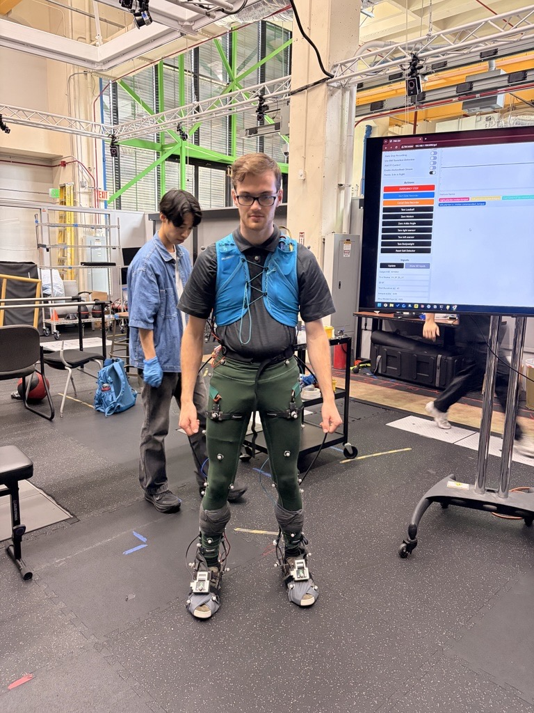 
      <em>Full Assistive Exoskeleton & Optical Mocap Integration</em>
    </td>
  </tr>
</table>

<em>Figure 1: Wearable Platform Architecture: Standalone Sensor Garment (Left) and Integrated Active Exoskeleton System (Right)</em>

## EPIC Labs, Mechanical Lead

Optical motion capture systems restrict biomechanical gait analysis to controlled lab spaces. At EPIC Labs, we developed a field-deployable motion capture garment integrated with active lower-body assistive exoskeletons for clinical stroke rehabilitation and energy harvesting research. The mechanical goal was to maintain continuous sensor-to-skin registration, route wiring securely, and simplify donning and doffing for individuals with motor impairments.

  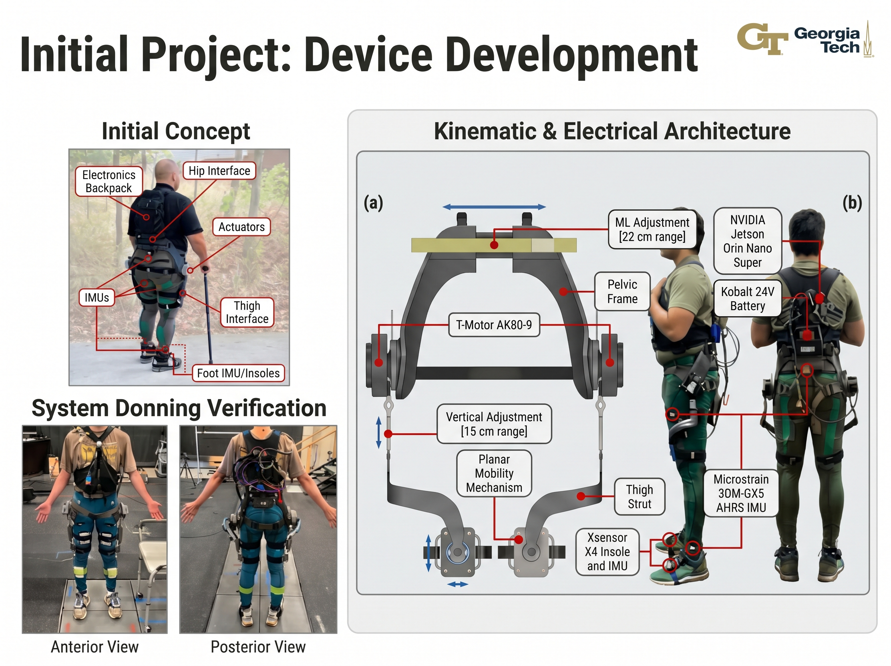 
  <em>Figure 2: Lower-Body Exoskeleton Architecture and Wearable Subsystem Integration Overview</em>

As the Mechanical Lead, I owned the mechanical redesign of our Version 2 sensor suit, CAD modeling, technical apparel prototyping, additive manufacturing, and wearable sensor packaging. I also led the mechanical updates for hip and pelvic attachments to align robotic joint axes with human anatomy. Key accomplishments:

### Hip and Pelvic Structure Redesign
I updated the pelvic interface in CAD to improve anatomical fit and load transfer across body types. The assembly features an adjustable center track with a 22 cm adjustment range to dial in inter-hip width without adding bulk. I redesigned the curved hip load-transfer brackets and battery mounting interfaces to follow pelvic contours and maintain joint alignment with powered exoskeleton drives. These components were 3D-printed on Bambu Lab systems to quickly validate the new kinematic geometry and test mechanical integration with the existing exoskeleton chassis before machining final production parts from high-durability materials.

<table align="center" width="100%">
  <tr>
    <td align="center" valign="top" width="50%">
      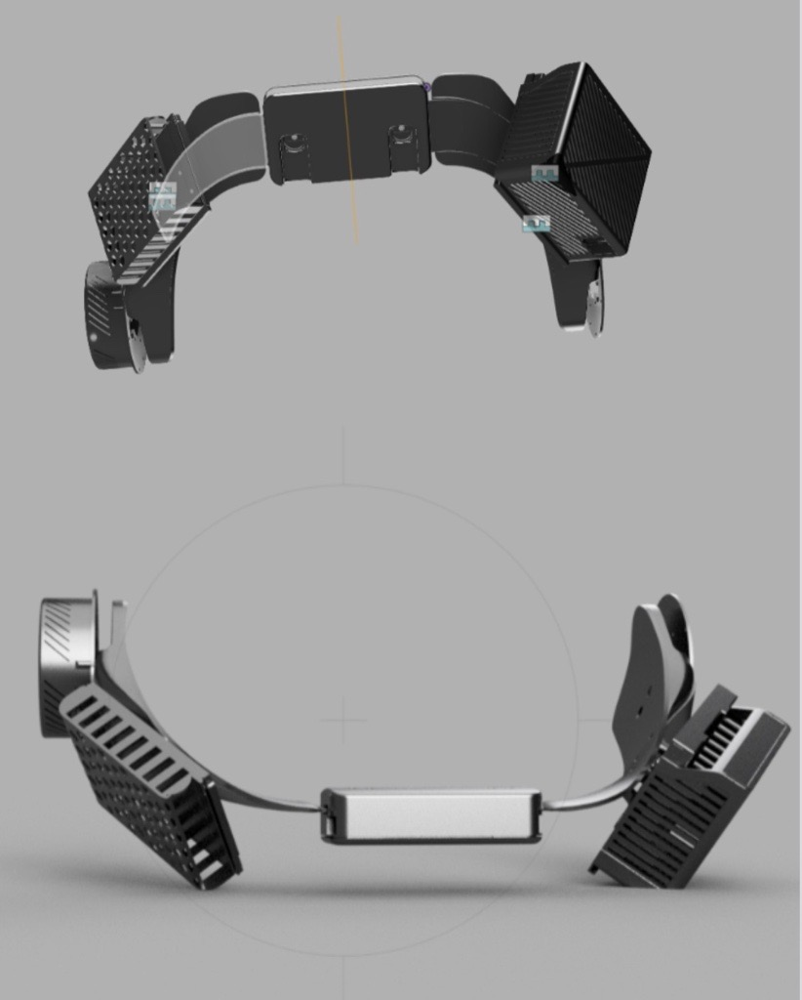 
      <em>Contoured Pelvic Frame Top and Underside Geometry</em>
    </td>
    <td align="center" valign="top" width="50%">
      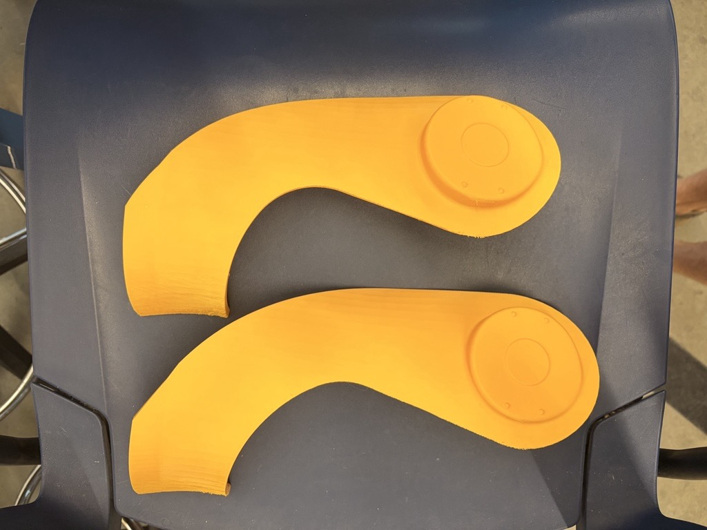 
      <em>3D-Printed Rapid Prototyping Struts</em>
    </td>
  </tr>
</table>

<em>Figure 3: Pelvic Mechanism Synthesis: Multi-Angle CAD Model (Left) and Finished Rapid-Prototyped Struts (Right)</em>

### Technical Apparel Prototyping and Lateral Zipper Integration
To resolve donning issues with earlier prototypes, I overhauled the physical construction for our Version 2 sensor suit. I integrated full-length lateral two-way zippers along the outer leg seams, pinning and sewing the tracks with reinforced stretch stitching. The dual-slider design allows users to open the garment from either the top or bottom, making it easy to pull on without assistance. The zipper plackets were reinforced to prevent binding and ensure the compression fabric holds the sensors securely against the skin during movement.

<table align="center" width="100%">
  <tr>
    <td align="center" valign="top" width="50%">
      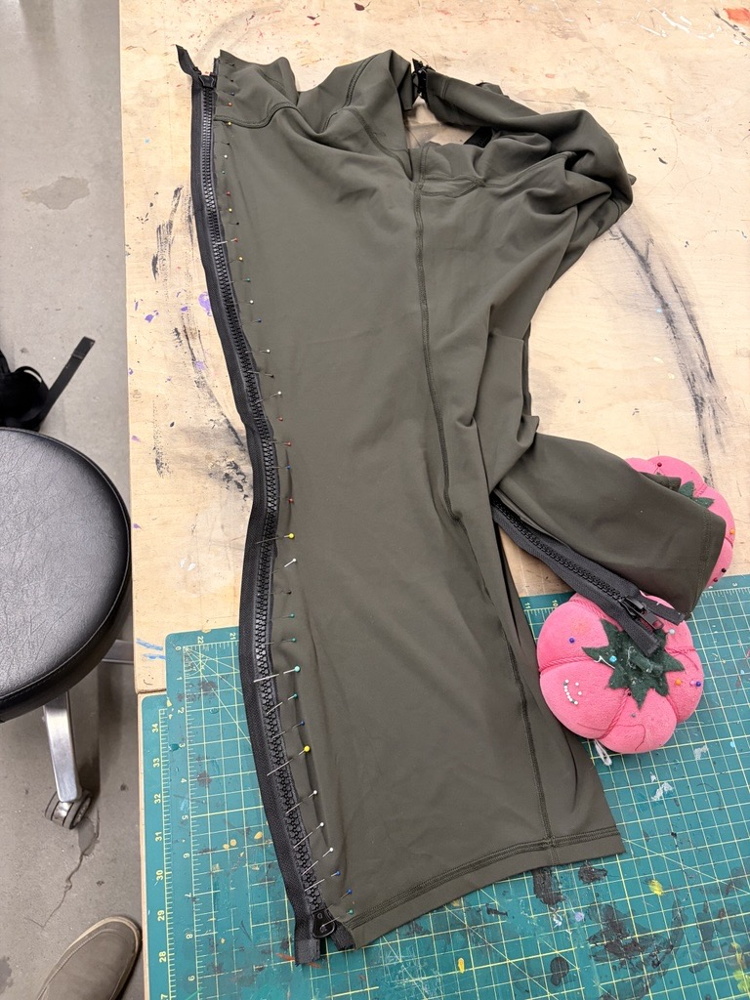 
      <em>Zipper Track Pinning and Seam Alignment</em>
    </td>
    <td align="center" valign="top" width="50%">
      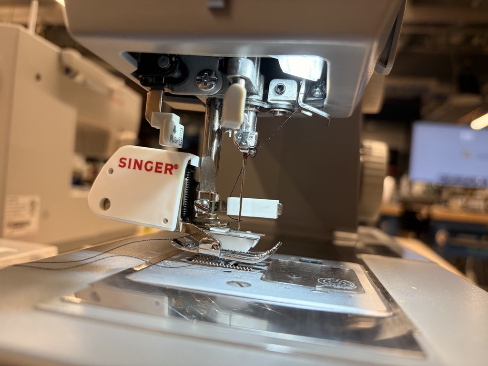 
      <em>Reinforced Stretch Seam Machine Sewing</em>
    </td>
  </tr>
</table>

<em>Figure 4: Garment Fabrication: Seam Pinning Layout (Left) and Reinforced Stitch Construction (Right)</em>

### Physical Garment Iteration and Cable Management
I refined the garment across multiple builds, transitioning from our early prototypes to the Version 2 suit. I integrated elastic routing pouches and Velcro closure flaps directly along the thighs and shanks. These pockets protect wire breakout bundles and give lines enough slack during deep knee flexion while keeping conductors from catching on exoskeleton struts.

<table align="center" width="100%">
  <tr>
    <td align="center" valign="top" width="50%">
      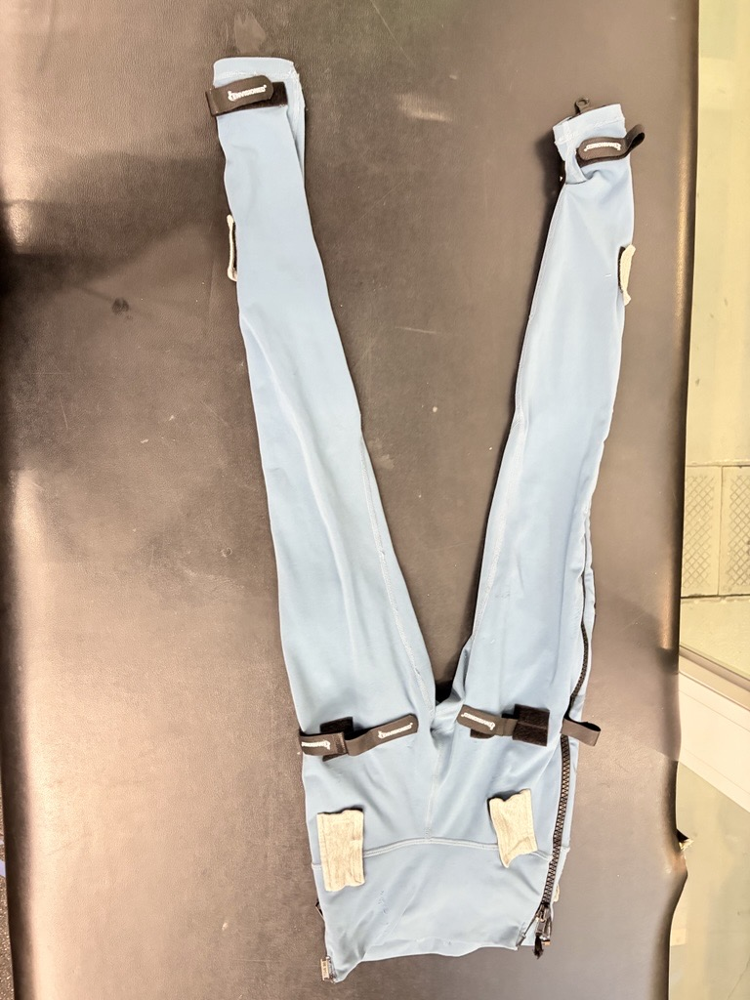 
      <em>Version 2 Suit Architecture and Routing Pouches</em>
    </td>
    <td align="center" valign="top" width="50%">
      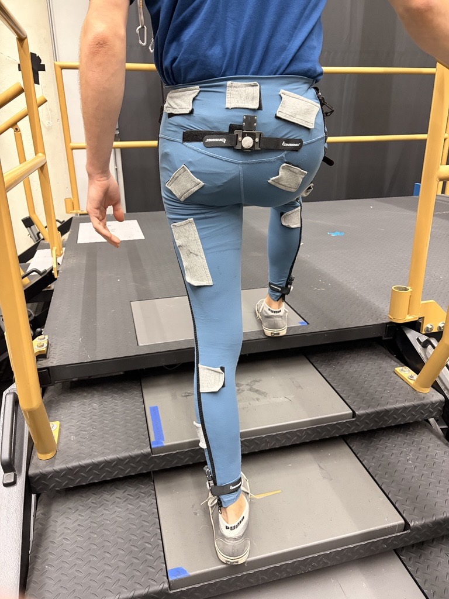 
      <em>Dynamic Knee Flexion and Rear Cable Clearance</em>
    </td>
  </tr>
</table>

<em>Figure 5: Apparel Iteration: V2 Suit Flat Architecture (Left) and Dynamic Knee Flexion Tracking (Right)</em>

### Electronics Packaging and Exoskeleton Hardware Interface
I modeled custom 3D-printed enclosures for motor driver electronics, batteries, and IMU sensor pods. The housings feature ventilated covers to disperse heat, strap slots for cuff retention, and brass heat-set inserts for reliable servicing. I also refined the mounting interface where rigid carbon fiber exoskeleton linkages clamp over the suit, ensuring no pinch points occur across joint axes.

<table align="center" width="100%">
  <tr>
    <td align="center" valign="top" width="50%">
      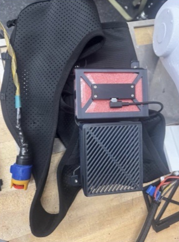 
      <em>Ventilated Electronics Housing and Power Harness</em>
    </td>
    <td align="center" valign="top" width="50%">
      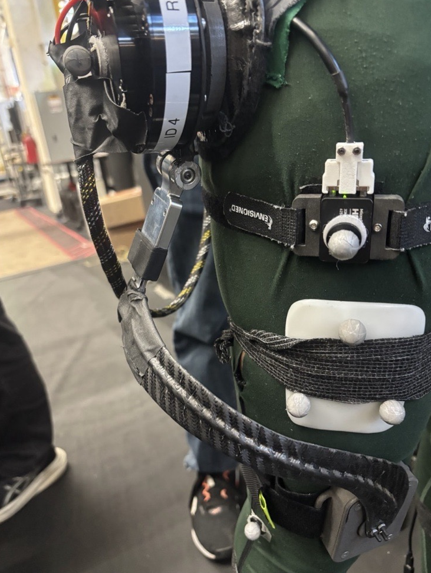 
      <em>Carbon Fiber Exoskeleton Hip Linkage and IMU Mount</em>
    </td>
  </tr>
</table>

<em>Figure 6: Hardware Packaging: Ventilated Controller Tray (Left) and Powered Exoskeleton Hip Linkage (Right)</em>

### Multi-Tiered Verification and Dynamic Gait Trials
We tested design upgrades through a structured four-stage evaluation pipeline. I ran initial mechanical bench checks on zipper tracking and pod clearance, followed by usability reviews with the engineering team. Once approved by our lead researcher, the suit moved into active collection protocols. We evaluated the system across our motion capture arena on instrumented walkways, stairs, and treadmills, confirming zero cable binding, stable sensor placement, and faster donning times for both able-bodied users and clinical participants.

<table align="center" width="100%">
  <tr>
    <td align="center" valign="top" width="50%">
      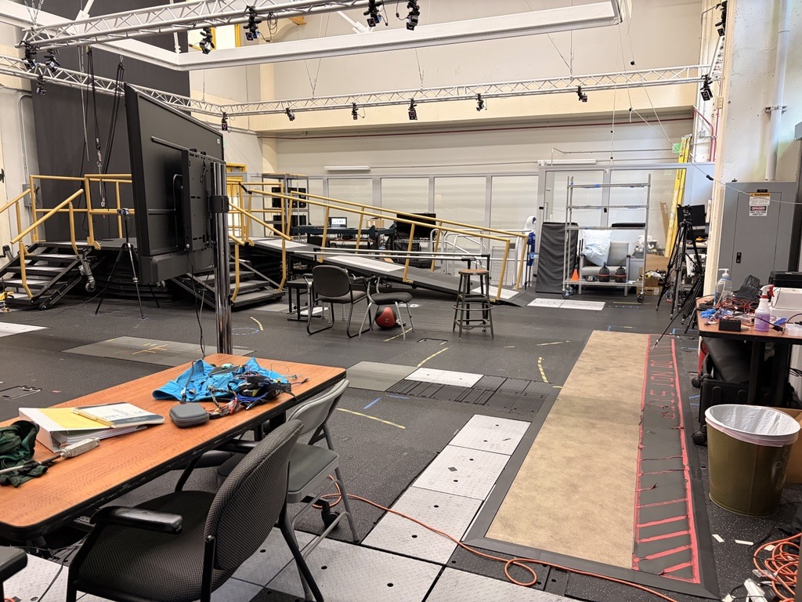 
      <em>EPIC Labs Optical Motion Capture and Incline Walkways</em>
    </td>
    <td align="center" valign="top" width="50%">
      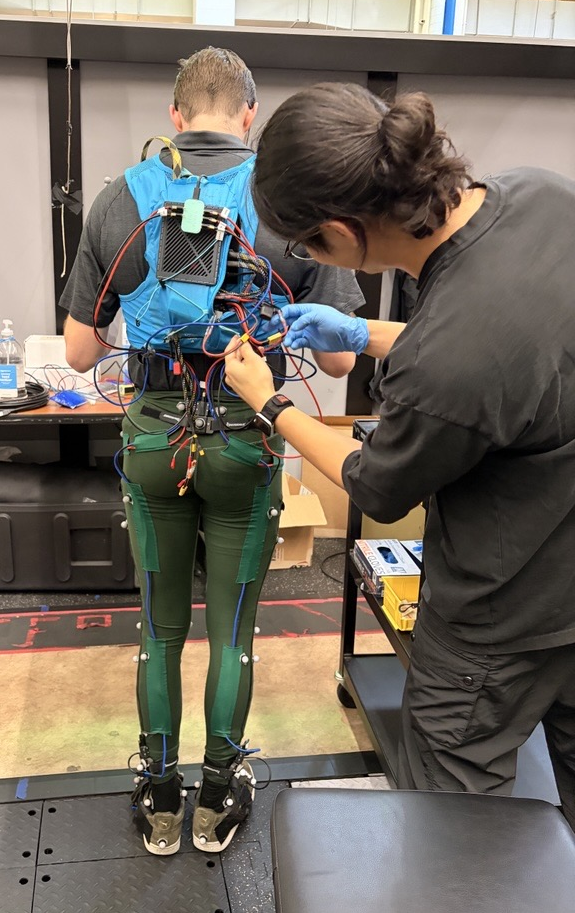 
      <em>Researcher Verification of Wiring Harness and Pelvic Mounts</em>
    </td>
  </tr>
</table>

<em>Figure 7: Experimental Validation: Motion Capture Arena (Left) and Multi-Tiered Lab Verification (Right)</em>

